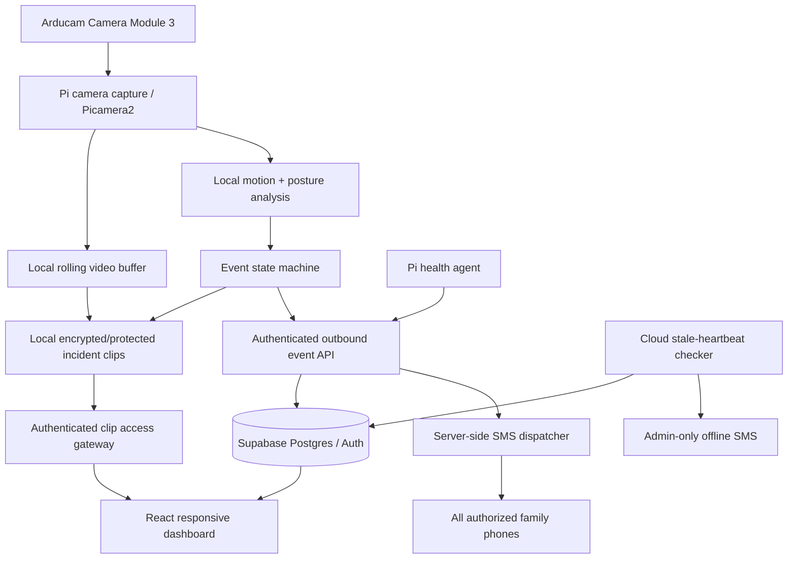
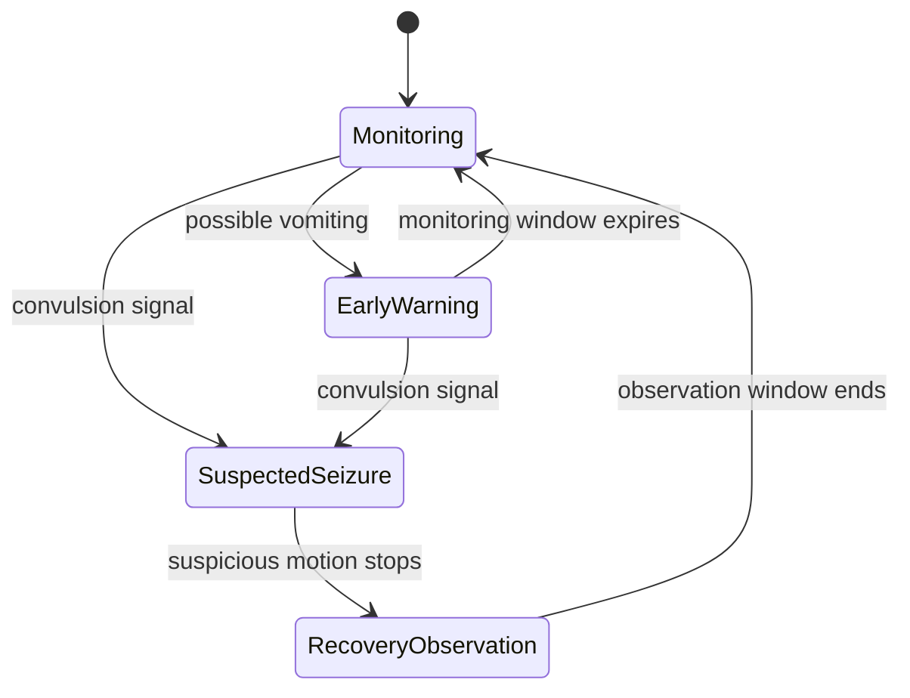

# Vigil — Design Specification

**Status:** Accepted for implementation (2026-11-14); not a validated medical device  
**Date:** 2026-11-14  
**Companion:** [`CLAUDE.md`](../CLAUDE.md) (engineering rules), [`DECISIONS.md`](DECISIONS.md) (architecture decision log)

> **Naming.** The official project name is **Vigil**. Earlier drafts called it the "Canine Seizure Monitoring System".

## 1. Purpose and boundaries

Build a privacy-first, continuously operating home camera system that flags **possible vomiting** and **possible convulsive seizures** in a dog, preserves short incident clips, and alerts authorized family members. It is an experimental aid, not a diagnosis, prediction guarantee, emergency service, or replacement for human supervision and a veterinarian-approved seizure response plan. Video-only detection can miss seizures, especially when the dog is obscured, out of frame, or lighting changes.

### Known context
- Dog usually stays in a lit living room within a fixed camera's field of view.
- Reported seizures involve full-body shaking, typically about 60–90 seconds.
- Vomiting has sometimes preceded seizures, with variable delay; this is **not** a reliable predictor.
- One handheld seizure recording exists for exploratory analysis; it is not sufficient to train or validate a classifier.
- Available hardware: Raspberry Pi 3 Model B+, Arducam Camera Module 3 (IMX708), microSD; Ring camera retained for its existing app, not assumed to provide a local video stream.
- Target additional spend: approximately $50–$100, subject to benchmarking.

### 1.1 Generalization beyond the first deployment

The first deployment watches one dog, but Vigil is designed so it could later serve other households, for example families who want to know if an elderly relative collapses. The core software therefore never hard-codes "dog" or "seizure":

- **Subject:** the individual being monitored (a dog, a person). Configured with a display name and a **profile**.
- **Profile:** a bundle of default detector thresholds, enabled detectors, and alert wording (e.g. `dog`, later `person`). Profiles are data, not code branches.
- **Signal types:** generic observable patterns produced by detectors: `convulsion`, `vomiting`, and reserved future types such as `fall` and `prolonged_inactivity`.
- **Detectors:** pluggable components that score analysis windows for one signal type. Each runs in `off`, `shadow` (scored and logged, never alerts), or `alert` mode.
- **Severity:** `warning` (early warning) or `urgent`. A profile maps each signal type to a severity.

The dog profile maps `vomiting → warning` and `convulsion → urgent`. A future person profile would add a fall detector without changing the capture, incident, recording, or notification layers. Monitoring people raises stronger consent, privacy, and medical-device regulatory obligations; these must be reviewed before any release beyond personal use.

## 2. Confirmed product decisions

| Topic | Decision |
|---|---|
| Monitoring | 24/7 continuous, automatic startup after reboot; explicit maintenance mode |
| Processing | Local-first; do not stream continuous living-room footage to cloud |
| Alerts | Early warning for possible vomiting; urgent alert for suspected seizure, independently of vomiting |
| Recipients | All authorized family members notified concurrently for event alerts |
| Escalation | One or two additional SMS reminder rounds for unacknowledged urgent alerts; no automatic calls in MVP |
| Family workflow | Acknowledge, claim response, confirm checked/resolved; acknowledgement alone never means safe |
| Access | Family can view authorized incident clips; only administrator can change settings, download or permanently preserve clips |
| Retention | Automatically expire ordinary incident clips; allow administrator to preserve selected clips |
| Status | Dashboard shows monitoring health; no routine daily health messages |
| Outage alert | Notify **administrator only** if monitoring unexpectedly goes offline |
| Client | Mobile-friendly React website for MVP |

## 3. MVP scope

**In scope:** camera capture; continuous lightweight analysis; possible-vomiting and suspected-convulsion events; local pre/post event video buffer; SMS fan-out; incident dashboard; family login and authorization; health telemetry; storage quota/retention; event labeling; administrative settings; restart/recovery.

**Out of scope:** clinical diagnosis, guaranteed prediction, autonomous emergency dispatch, automated phone calls, training a deep-learning seizure classifier from a single clip, unrestricted remote live stream, public clip URLs, Ring feed integration, mobile native apps.

## 4. Proposed architecture

**Connectivity:** The Pi initiates outbound encrypted connections; never expose its camera, SSH, or clip server directly to the public internet. Clip access is an unresolved engineering choice: prefer a short-lived authenticated request via a secure outbound tunnel or tightly scoped, encrypted event-only upload. Evaluate feasibility and cost before implementation. Do not promise remote viewing of purely local clips without a secure delivery path.

**Failure isolation:** Video capture and detection continue locally during internet outages. Persist events in a bounded local queue and retry sync. Cloud SMS cannot be delivered during a complete home internet outage unless an independent connection exists. A cloud heartbeat monitor can report a missing heartbeat to the admin if the cloud service remains available.

## 5. Detection design

### 5.1 Staged approach
1. **Capture and observability:** Camera health, timestamps, FPS, exposure, and dropped-frame metrics.
2. **Baseline movement:** Fixed-camera regions of interest, background subtraction / optical flow, motion periodicity and duration; record ordinary sleeping, scratching, grooming, rolling, walking, and human movement.
3. **Dog localization:** Optional lightweight detector/pose model if Pi 3 benchmark allows; otherwise bounded ROI plus conservative motion heuristics.
4. **Possible vomiting:** Candidate retching/postural cues, lower confidence, independently configurable threshold. Vomiting can occur without seizures and can be difficult to detect visually.
5. **Suspected convulsions:** Sustained rhythmic whole-body motion, posture changes, and temporal consistency; does not require a prior vomiting event.
6. **Validation:** Evaluate on separately collected clips; do not report medical sensitivity/specificity without an appropriately labeled representative dataset and veterinary review.

### 5.2 Event state machine

Suggested **configurable experimental defaults**: initial suspicious-motion persistence 10–15 seconds; possible-vomiting heightened observation 10 minutes; pre-event buffer 30 seconds; post-event recording 2 minutes. These are engineering hypotheses, not medically validated thresholds. Avoid repeated alerts for the same continuous event; allow independent events after a cooldown. Alert latency should be measured from observable onset and balanced against false alarms.

### 5.3 Clip handling
- Circular pre-event buffer stored locally; event clip includes lead-in, full event, and post-event tail.
- Store capture timestamp, model/rule version, detection confidence/features, clip integrity hash, and whether human verified.
- Normal operation must not persist continuous full-day recordings.
- Default ordinary retention proposal: **30 days** (admin-adjustable); enforce both age-based expiry and disk quota, with reserve free space and oldest-unprotected-first deletion. Confirm final duration in settings design.
- Preserved clips exempt from routine expiry but remain subject to an administrator-visible storage policy; warn before capacity is exhausted. Keep encryption keys separate from the clip directory where feasible.

## 6. Incident response and notifications

**Early warning:** “Possible vomiting observed” with time and incident link. Do not say a seizure is imminent.

**Urgent:** “Possible seizure-like movement observed” with time and secure incident link; notify all family contacts concurrently. Provide one or two configurable SMS reminder rounds if no one acknowledges, with idempotency and rate limits. SMS providers and phone OS delivery cannot guarantee simultaneous or immediate receipt.

**Incident lifecycle:** `open` → `acknowledged` / `responding` → `checked` → `resolved`, plus `false_positive` and `needs_review`. Track actor and timestamps; claiming response does not imply clinical safety. Family can annotate and view; only admin can preserve/download or alter settings. No direct video attachments in SMS.

**Veterinary safety:** A seizure lasting 5 minutes or more, repeated seizures without recovery, or breathing difficulty warrants urgent veterinary care. Emergency guidance must be supplied or approved by the dog's veterinarian; the app must not autonomously diagnose or give medication instructions.

## 7. Identity, permissions, and security

| Capability | Administrator | Family member |
|---|---:|---:|
| View dashboard and incidents | Yes | Yes |
| View authorized incident clips | Yes | Yes |
| Acknowledge / respond / resolve | Yes | Yes |
| Label suspected false positive | Yes | Yes |
| Download or permanently preserve clips | Yes | No |
| Invite/revoke users, configure rules, retention, contacts | Yes | No |
| Receive event alerts | Yes | Yes |
| Receive offline alert | **Yes** | No |

Use Supabase Auth with MFA for admin, least-privilege Row Level Security, server-side authorization on **every** clip request and administrative action, expiring access tokens, HTTPS/TLS, encrypted-at-rest storage where possible, secret rotation, audit logs, and no credentials in repository. Browser controls cannot technically prevent all copying/screen recording of viewed video; “no download” means no download endpoint or UI for family, not an absolute anti-copy guarantee. Avoid exposing indoor footage in logs, analytics, or third-party monitoring. Collect explicit consent from household members as appropriate.

## 8. Health, uptime, and recovery

- Pi sends heartbeat with camera capture state, detection-loop state, last frame timestamp, local queue depth, disk free space, temperature, and software version.
- Dashboard status: `online`, `degraded`, `offline`, `maintenance`, `unknown`; derive from fresh heartbeat and component checks, never merely from website availability.
- A cloud scheduled checker marks stale heartbeats and sends **admin-only** offline notification after a configurable grace period; deduplicate alerts and send a recovery notification optionally.
- Run local services with systemd restart policy, bounded logs, startup checks, and watchdog; safely recover from power/network failures.
- Avoid false online claims if camera is disconnected but Pi is reachable.
- Health metrics and alerts should not include live camera frames.

## 9. Data model (initial proposal)

- `households(id, name, created_at)`
- `memberships(id, household_id, user_id, role, active)`
- `notification_contacts(id, membership_id, phone_e164, verified_at, enabled)`
- `devices(id, household_id, name, last_heartbeat_at, status, software_version)`
- `device_health(id, device_id, captured_at, camera_ok, detector_ok, fps, disk_free_bytes, queue_depth)`
- `incidents(id, household_id, device_id, type, severity, status, started_at, ended_at, confidence, rule_version, created_at)`
- `incident_events(id, incident_id, actor_id, event_type, created_at, metadata)`
- `clips(id, incident_id, storage_key, starts_at, ends_at, expires_at, preserved_at, checksum, bytes)`
- `notifications(id, incident_id, contact_id, channel, round, provider_id, status, attempted_at)`
- `settings(household_id, thresholds_json, retention_days, disk_quota_bytes, escalation_json)`

Use migrations, foreign keys, indexed household/time/status fields, and database-enforced authorization. Treat `confidence` as an uncalibrated engineering score until validation establishes calibration.

## 10. Proposed software stack

- **Edge:** Raspberry Pi OS Lite, Python 3, Picamera2/libcamera, OpenCV, NumPy, systemd, SQLite durable local event queue.
- **Web:** React + TypeScript + Vite, responsive accessible UI, minimal dependencies.
- **Backend:** Supabase Postgres/Auth/Row Level Security; server-side Edge Functions or equivalent for event ingestion and SMS dispatch.
- **Messaging:** Twilio or another SMS provider; use sandbox/test mode before live fan-out. Budget for per-message costs.
- **Video:** Local segmented H.264 recording; authenticated retrieval or encrypted event-only upload after choosing secure clip-delivery architecture.

Hardware caveat: Pi 3 B+ has limited CPU/RAM and the camera ribbon/compatibility must be verified. First benchmark capture, encoding, analysis FPS, CPU load, memory, temperature, and 24-hour stability. A Pi 5 or mini PC is a conditional upgrade, not an MVP assumption. Verify the camera module's actual ribbon connector rather than assuming a specific kit cable.

## 11. Acceptance criteria and test plan

**Functional:** 24/7 startup; capture usable frames; detect synthetic/replayed motion events; create one incident per episode; all family contacts receive attempted SMS fan-out; family acknowledges and views clip; admin-only settings/download; expired clips deleted; offline heartbeat alerts only admin.

**Reliability:** 24-hour soak test, restart after power loss, camera unplug/replug, network outage and reconnection, full-disk simulation, stale heartbeat, repeated SMS prevention, clock/timezone correctness, queue replay without duplicate incidents.

**Security:** Attempt unauthorized API reads/writes, cross-household access, forged clip URLs, expired tokens, role escalation, replayed device requests, secret leakage, and direct-port scans.

**Detection:** Curate labeled normal activity and any consented veterinary-reviewed episodes; measure event-level recall, false alerts per day, detection latency, and failures under occlusion/lighting. Do not deploy as a trusted safety monitor without substantial evaluation; retain human checks and veterinary plan.

**Targets to agree after pilot:** acceptable false alerts/day, acceptable latency, minimum detection FPS, outage threshold, uptime, and retention period. Avoid fabricated accuracy guarantees.

## 12. Phased roadmap and exit gates

> **Implementation numbering.** The owner's implementation brief renumbers the phases as: 0 foundation, 1 offline detection prototype (including the rule-based incident state machine for replay), 2 Pi camera integration and benchmark, 3 cloud backend and notifications, 4 web dashboard, 5 reliability/security/validation (including the pilot). `CLAUDE.md` tracks that numbering; the gates below still apply to the matching work.

**Phase 0 — Design review:** Finalize camera placement, privacy/consent, clip access design, retention, response plan, and success metrics. Gate: approved spec.

**Phase 1 — Offline analysis:** Inspect sample seizure clip and normal videos on Mac; prototype optical flow/periodicity and evaluation harness. Gate: reproducible metrics and known failure cases.

**Phase 2 — Edge capture:** Install Pi OS, connect Arducam, test Picamera2, circular buffer, health checks, 24-hour benchmark. Gate: stable capture without exhausting disk.

**Phase 3 — Incident engine:** Add rule-based event state machine, local event store, event clip capture, configurable thresholds, replay tests. Gate: stable incident creation with documented false positives.

**Phase 4 — Secure backend/UI:** Implement auth, RLS, incidents, family roles, admin-only settings, health dashboard, secure clip delivery. Gate: permissions tests pass.

**Phase 5 — Notifications:** Implement concurrent SMS fan-out, reminder rounds, admin-only outage SMS, deduplication, audit. Gate: end-to-end dry run passes.

**Phase 6 — Pilot:** Shadow-mode testing with human review, reliability/security validation, threshold tuning, veterinarian input. Gate: explicit documented limitations and go/no-go decision; no claim of medical-grade reliability.

## 13. Open decisions

1. Exact clip retention duration (30 days proposed) and max storage quota.
2. Remote clip access mechanism: secure outbound tunnel vs encrypted event-only upload.
3. Notification reminder timing and number (one or two rounds confirmed; timing TBD).
4. Which family members can mark `resolved` versus `checked` (all assumed for MVP).
5. Camera mounting angle and whether dog remains visible in low light despite usual lights-on behavior.
6. Measurable alert-latency/false-positive thresholds after baseline evaluation.
7. Device provisioning, key storage, and backup/restore strategy.

## 14. Engineering principles

Build detection and cloud components independently. Keep continuous video local. Prefer simple, testable heuristics over unsupported AI claims. Fail visibly, never silently; never report monitoring active without fresh proof. Treat suspected events as uncertain. Keep operational costs low and provide privacy controls. Design review was accepted by the owner on 2026-11-14; implementation proceeds phase by phase per `CLAUDE.md`.
